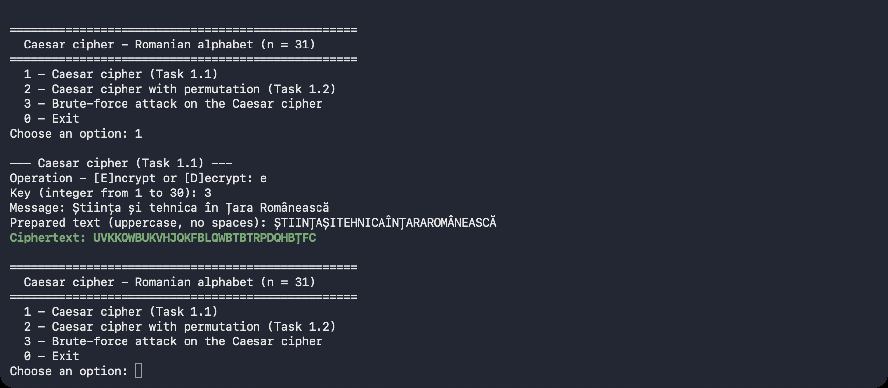
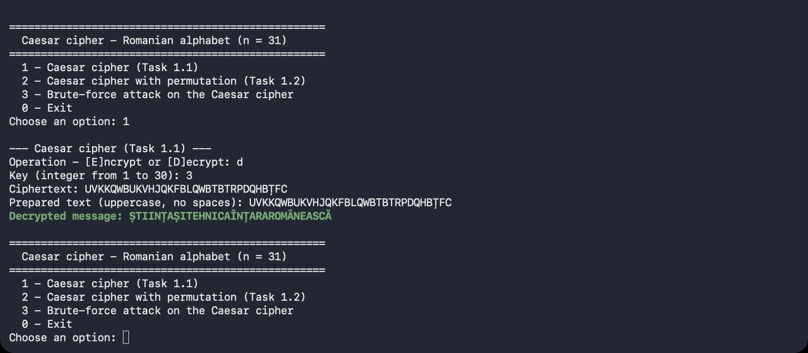
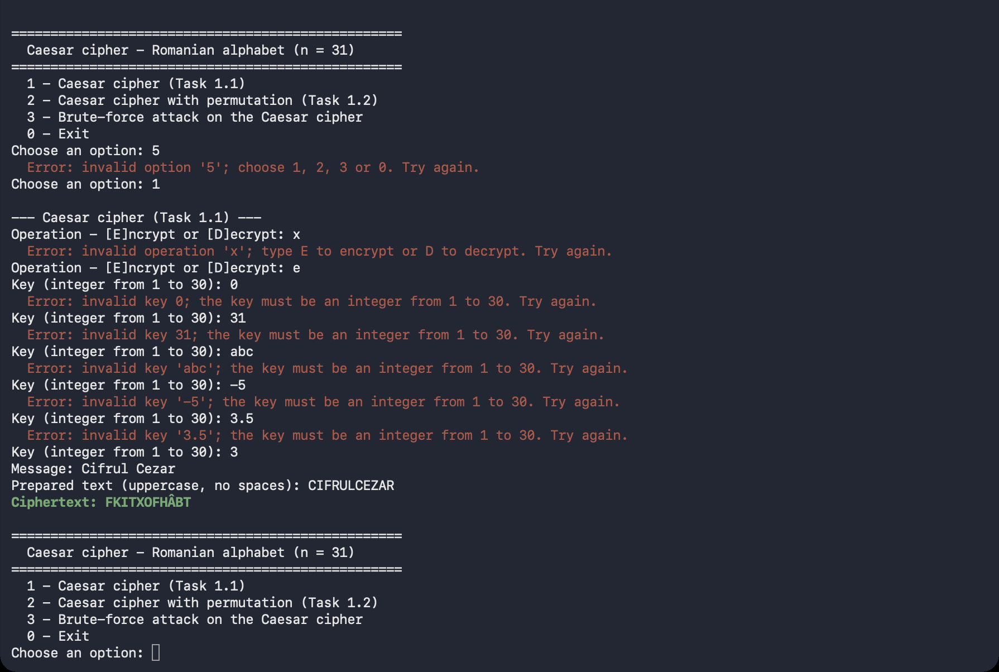
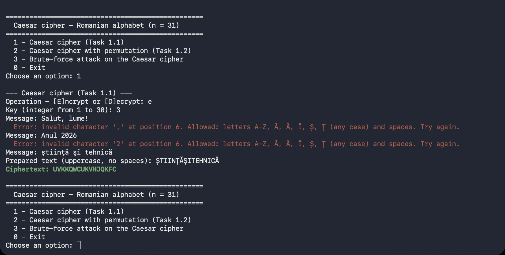
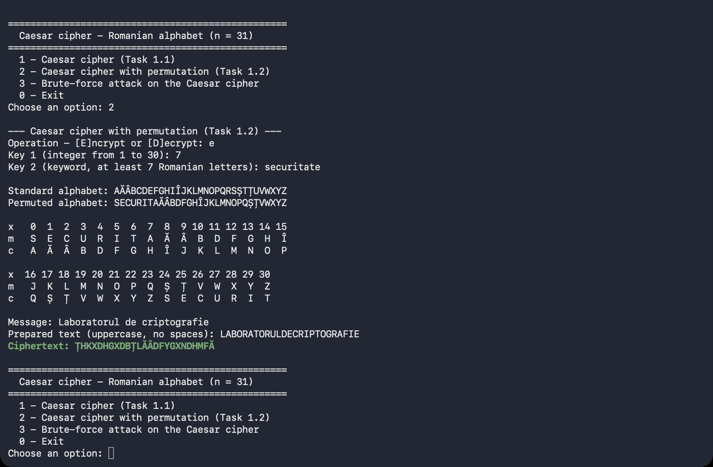
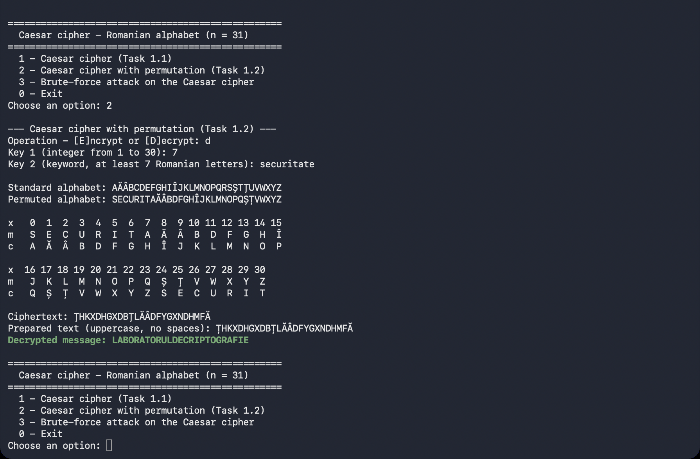
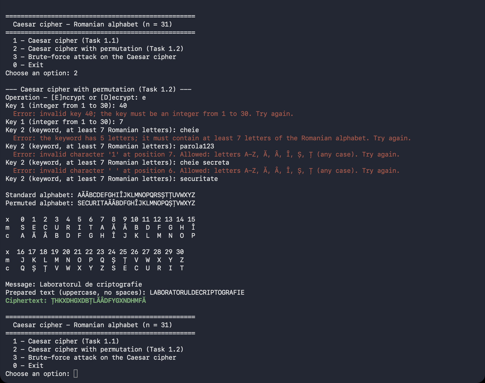
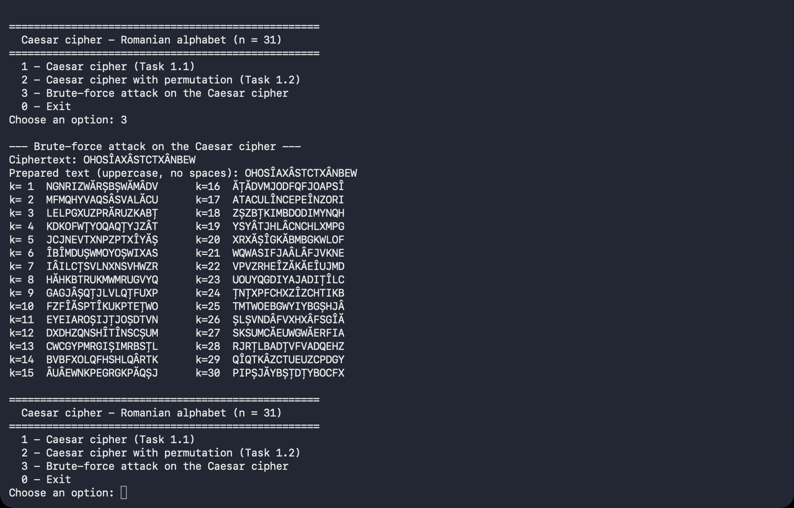

# Laboratory Work No. 1 · Caesar Cipher

**Topic:** the Caesar cipher and the Caesar cipher with a permuted alphabet, implemented for the Romanian alphabet

**Author:** Nichita Rusnac · **Group:** FAF-242

Technical University of Moldova, FCIM · Cryptography and Security · 8 October 2026

---

## 1. Short theory

### 1.1 The Caesar cipher

Every letter is replaced by the letter found a fixed number of positions further in the alphabet. The letters are numbered from 0. For the Romanian alphabet n = 31, and the codes are those of Table 2 of the lab (A = 0, Ă = 1, Â = 2, … , Z = 30). The key k is the shift, k ∈ {1, 2, …, n − 1}. The same key is used for both directions:

```
encryption:  c = e_k(x) = (x + k) mod n
decryption:  m = d_k(y) = (y − k) mod n
```

Here x is the code of a plaintext letter and y the code of a ciphertext letter. When x + k ≥ n or y − k < 0 the result "wraps around" the alphabet. For example, with n = 31 and k = 3, Z (30) becomes (30 + 3) mod 31 = 2 = Â, and decrypting  gives (2 − 3) mod 31 = 30 = Z.

**Key space:** n − 1 keys, which is 25 for the English alphabet and **30 for the Romanian alphabet**. An attacker can simply try all of them (brute force). Exactly one key gives readable text.

### 1.2 The Caesar cipher with a permutation

A second key, a keyword k₂, reorders the alphabet before the shift is applied:
1. Write the letters of the keyword, keeping only the first occurrence of each letter.
2. Append the remaining letters of the alphabet in their natural order.

For example, with k₂ = `SECURITATE` the 31-letter Romanian alphabet becomes

```
standard:  A Ă Â B C D E F G H I Î J K L M N O P Q R S Ș T Ț U V W X Y Z
permuted:  S E C U R I T A Ă Â B D F G H Î J K L M N O P Q Ș Ț V W X Y Z
```

The formulas stay the same, `c = (x + k₁) mod n` and `m = (y − k₁) mod n`. The only change is that x and y are now positions in the **permuted** alphabet.

**Key space:** n! orderings × (n − 1) shifts.
- English: 26! × 25 ≈ 1.01 · 10²⁸.
- Romanian: 31! × 30 = 246,685,159,625,337,684,531,766,886,400,000,000 ≈ **2.47 · 10³⁵**.

A keyword can be as long as the whole alphabet, so all 31! orderings are reachable. Different key pairs can give the same substitution, so there are at most 31! distinct encryptions. The cipher is still **monoalphabetic**: each plaintext letter is always replaced by the same ciphertext letter. As a result, the letter frequencies of the language remain visible in the ciphertext.

## 2. Implementation

The program is written in Python 3 (standard library only). It is an interactive console application.

| File | Contents |
|---|---|
| `alphabet.py` | the Romanian alphabet (Table 2), case conversion, text preparation |
| `cipher.py` | encryption/decryption, the permuted alphabet, brute force |
| `validation.py` | parsing and validation of the keys, the text and the keyword |
| `main.py` | the menu and the dialogue with the user |
| `tests/` | 42 unit tests (`unittest`) |
| `scripts/` | the scripts that produced the screenshots in section 3 |

### 2.1 Letter encoding

```python
# Table 2 of the lab: the position of a letter in this tuple is its code.
ROMANIAN_ALPHABET = (
    "A", "Ă", "Â", "B", "C", "D", "E", "F", "G", "H", "I",
    "Î", "J", "K", "L", "M", "N", "O", "P", "Q", "R", "S",
    "Ș", "T", "Ț", "U", "V", "W", "X", "Y", "Z",
)
N = len(ROMANIAN_ALPHABET)

LETTER_TO_CODE = {letter: code for code, letter in enumerate(ROMANIAN_ALPHABET)}
```

The alphabet is a tuple in the exact order of Table 2, so the code of a letter is its index. A letter is turned into a number only through this table, never through `ord()` or Unicode code points, as the task requires. `Ș` and `Ț` are the correct comma-below letters (U+0218, U+021A).

### 2.2 Converting the input to uppercase letters

```python
_LOWERCASE = (
    "a", "ă", "â", "b", "c", "d", "e", "f", "g", "h", "i",
    "î", "j", "k", "l", "m", "n", "o", "p", "q", "r", "s",
    "ș", "t", "ț", "u", "v", "w", "x", "y", "z",
)
TO_UPPERCASE = {letter: letter for letter in ROMANIAN_ALPHABET}
TO_UPPERCASE.update(zip(_LOWERCASE, ROMANIAN_ALPHABET))
# S and T with a cedilla are often typed instead of the comma-below letters.
TO_UPPERCASE.update({"Ş": "Ș", "ş": "Ș", "Ţ": "Ț", "ţ": "Ț"})

def prepare_text(raw, allow_spaces=True):
    # NFC joins decomposed input (e.g. "S" + combining comma below) into one letter.
    text = unicodedata.normalize("NFC", raw)
    letters = []
    for position, char in enumerate(text, start=1):
        if char == " " and allow_spaces:
            continue
        if char not in TO_UPPERCASE:
            hint = ALLOWED_LETTERS_HINT + (" and spaces" if allow_spaces else "")
            raise ValueError(f"invalid character {char!r} at position {position}. {hint}.")
        letters.append(TO_UPPERCASE[char])
    if not letters:
        raise ValueError("the text must contain at least one letter.")
    return "".join(letters)
```

`TO_UPPERCASE` lists every character that is accepted and the uppercase letter it stands for. It maps the 31 uppercase letters to themselves, their lowercase forms to them, and Ş/ş/Ţ/ţ (cedilla) to Ș/Ț, as the implementation tip of the lab suggests. `prepare_text` removes spaces, converts the text to uppercase and stops at the first character that is not allowed. The error message names that character and its position.

I deliberately did not use `str.upper()`. It would also "accept" characters such as `ß` (it becomes `SS`), the Turkish `ı` (it becomes `I`) or `ſ` (it becomes `S`). The explicit table rejects them. The `NFC` normalisation makes text with decomposed diacritics (a base letter followed by a combining mark) work as well.

### 2.3 Encryption and decryption

```python
def _shift(text, key, alphabet):
    code_of = {letter: code for code, letter in enumerate(alphabet)}
    n = len(alphabet)
    # Python's % always returns a value in 0..n-1 for n > 0, so (y - k) mod n
    # needs no extra correction when y - k is negative.
    return "".join(alphabet[(code_of[letter] + key) % n] for letter in text)


def encrypt(text, key, alphabet=ROMANIAN_ALPHABET):
    """c = (x + k) mod n for every letter x of the text."""
    return _shift(text, key, alphabet)


def decrypt(text, key, alphabet=ROMANIAN_ALPHABET):
    """m = (y - k) mod n for every letter y of the ciphertext."""
    return _shift(text, -key, alphabet)
```

Both operations reduce to one shift: +k for encryption and −k for decryption. The functions take the alphabet as a parameter. The same code serves both tasks: Task 1.1 uses the standard alphabet and Task 1.2 the permuted one. It also let me test the code with the English examples from the lab statement. The lab warns that some languages return negative remainders. In Python, `(1 - 3) % 31` is already `29`, so no correction is needed.

### 2.4 Building the permuted alphabet

```python
def build_permuted_alphabet(keyword, alphabet=ROMANIAN_ALPHABET):
    """Keyword letters first (each kept only once), then the rest of the alphabet."""
    permuted = []
    for letter in list(keyword) + list(alphabet):
        if letter not in permuted:
            permuted.append(letter)
    return tuple(permuted)


def encrypt_with_keyword(text, key, keyword, alphabet=ROMANIAN_ALPHABET):
    return encrypt(text, key, build_permuted_alphabet(keyword, alphabet))


def decrypt_with_keyword(text, key, keyword, alphabet=ROMANIAN_ALPHABET):
    return decrypt(text, key, build_permuted_alphabet(keyword, alphabet))
```

The keyword is followed by the whole alphabet, and a letter is added only the first time it appears. This drops repeated keyword letters and appends the remaining letters in natural order. The result always contains all 31 letters exactly once. Encryption and decryption are then the ordinary Caesar shift over the new order.

To make the result checkable by hand, the program prints the permuted alphabet as a table like Table 3 of the lab. Row `x` holds the positions, row `m` the permuted alphabet, and row `c` the letter each one is encrypted to. The table is split into two blocks so it fits the terminal (see Figure 5).

### 2.5 Input validation

```python
def parse_key(raw, n=N):
    """The shift key: an integer from 1 to n - 1."""
    allowed = f"the key must be an integer from 1 to {n - 1}."
    value = raw.strip()
    if not value:
        raise ValueError(f"no key was entered; {allowed}")
    # Only ASCII digits: rejects "-3", "3.5", "+3" and digits of other scripts.
    if not re.fullmatch(r"[0-9]+", value):
        raise ValueError(f"invalid key {value!r}; {allowed}")
    key = int(value)
    if not 1 <= key <= n - 1:
        raise ValueError(f"invalid key {key}; {allowed}")
    return key


def parse_keyword(raw):
    """Key 2: at least MIN_KEYWORD_LENGTH Romanian letters, no spaces."""
    keyword = prepare_text(raw.strip(), allow_spaces=False)
    if len(keyword) < MIN_KEYWORD_LENGTH:
        raise ValueError(
            f"the keyword has {len(keyword)} letters; it must contain "
            f"at least {MIN_KEYWORD_LENGTH} letters of the Romanian alphabet."
        )
    return keyword
```

Every parser either returns a valid value or raises `ValueError` with a message that states what is allowed.
- **Key:** only the digits 0–9 are accepted, followed by a range check, so `0`, `31`, `-5`, `3.5` and `abc` are all rejected.
- **Keyword:** it goes through the same character check as the text (spaces are not allowed in it). It is then converted to uppercase and its length is checked (at least 7 letters).

```python
def ask(prompt, parser):
    """Ask until `parser` accepts the input; show its error message otherwise."""
    while True:
        raw = input(prompt)
        try:
            return parser(raw)
        except ValueError as exc:
            print(error(f"  Error: {exc} Try again."))
```

The menu uses this one helper for every question (option, operation, key 1, key 2, text). An invalid value prints the message in red and asks for the same value again; nothing else is lost.

### 2.6 Checking the results by hand

**Task 1.1.** `CIFRUL CEZAR`, k = 3, codes from Table 2:

| m | C | I | F | R | U | L | C | E | Z | A | R |
|---|---|---|---|---|---|---|---|---|---|---|---|
| x | 4 | 10 | 7 | 20 | 25 | 14 | 4 | 6 | 30 | 0 | 20 |
| (x + 3) mod 31 | 7 | 13 | 10 | 23 | 28 | 17 | 7 | 9 | 2 | 3 | 23 |
| c | F | K | I | T | X | O | F | H | Â | B | T |

The ciphertext is `FKITXOFHÂBT`, which is what the program prints (Figure 3). It differs from the English `FLIUXOFHCDU` given in the lab because the Romanian alphabet has the extra letters Ă, Â, Î, Ș and Ț. For example, I + 3 lands on K instead of L, because Î sits between I and J.

**Task 1.2.** k₁ = 7, k₂ = `SECURITATE`. The permuted alphabet is `SECURITAĂÂBDFGHÎJKLMNOPQȘȚVWXYZ`. The first letters of `LABORATORUL…` are:
- L (position 18) → 25 = Ț
- A (7) → 14 = H
- B (10) → 17 = K
- O (21) → 28 = X
- R (4) → 11 = D

So the ciphertext starts with `ȚHKXD…`, as in Figure 5.

### 2.7 Testing

The code is covered by 42 unit tests, run with `python3 -m unittest discover tests -v`:

- **Lab examples (English alphabet):**
  - `CIFRULCEZAR`, k = 3 → `FLIUXOFHCDU`
  - `BRUTEFORCEATTACK`, k = 17 → `SILKVWFITVRKKRTB`, plus the brute-force table from the lab
  - keyword `CRYPTOGRAPHY` → `CRYPTOGAHBDEFIJKLMNQSUVWXZ`, and `CIFRULCEZAR` → `PLKTXQPJYDT`
- **Romanian alphabet:**
  - the codes of Table 2 and the wrap-around
  - the two hand-worked examples above
  - encrypt/decrypt round trips for every key from 1 to 30, for both ciphers
  - the permuted alphabet is always a permutation of all 31 letters
- **Input handling:**
  - lowercase letters, cedilla variants and decomposed diacritics are accepted
  - rejected keys: `0`, `31`, `-3`, `+3`, `3.5`, `abc`, empty, `٣`
  - rejected characters: `,`, `!`, digits, `ß`, `ı`, `é`, tab
  - a 6-letter keyword or a keyword containing a space or a digit is rejected; a 7-letter keyword is accepted
- **Console program:** driven with simulated keyboard input. The tests check the results, the error messages and that the program asks again after an error.

```
$ python3 -m unittest discover tests
..........................................
----------------------------------------------------------------------
Ran 42 tests in 0.005s

OK
```

## 3. Results

The screenshots are of the real program (`python3 main.py`) running in the macOS Terminal. To keep them reproducible, the inputs were typed into the window by `scripts/take_screenshots.sh`, using the input lists in `scripts/scenarios/`. Each screenshot was taken while the program was waiting at the menu after the operation. Error messages are shown in red and results in green.

### Task 1.1: Caesar cipher



*Figure 1. Encryption with k = 3. The message contains all five Romanian diacritics. It is converted to uppercase, the spaces are removed, and the result is encrypted.*



*Figure 2. Decrypting the ciphertext from Figure 1 with the same key gives back the prepared message.*



*Figure 3. Invalid input:*
- *a menu option that does not exist and an unknown operation;*
- *the keys `0`, `31`, `abc`, `-5` and `3.5`.*

*Each message states the allowed range, and the program asks for the same value again. With k = 3, `Cifrul Cezar` gives `FKITXOFHÂBT`, as computed by hand in 2.6.*



*Figure 4. Invalid characters in the message. The comma in `Salut, lume!` and the digit in `Anul 2026` are rejected, and each message names the character and its position. The last message is typed with the cedilla letters ş and ţ. It is accepted and converted to Ș and Ț.*

### Task 1.2: Caesar cipher with two keys



*Figure 5. Encryption with k₁ = 7 and k₂ = `securitate`. The program prints the standard and the permuted alphabet and the x/m/c table, which can be used to check the result by hand.*



*Figure 6. Decrypting the ciphertext from Figure 5 with the same two keys.*



*Figure 7. Invalid keys for Task 1.2: key 1 out of range (`40`), a keyword that is too short (`cheie`, 5 letters), a keyword with a digit (`parola123`) and a keyword with a space (`cheie secreta`). After each error the program asks for the key again.*

### Brute-force attack



*Figure 8. Brute force on a Task 1.1 ciphertext (an extra menu option). All 30 possible keys are tried instantly, and only k = 17 gives Romanian text: `ATACULÎNCEPEÎNZORI` ("atacul începe în zori").*

## 4. Conclusions

- **The plain Caesar cipher is not secure.** The Romanian alphabet gives only 30 keys. Figure 8 shows that trying all of them takes no time, and a human recognises the right plaintext at a glance. The secret is effectively a single number from 1 to 30.
- **The keyword makes brute force impossible, but the cipher stays weak.** With 31! × 30 ≈ 2.47 · 10³⁵ key pairs, even 10¹² keys per second would need about 7.8 · 10¹⁵ years. However, the cipher is still a monoalphabetic substitution: the same letter always becomes the same letter. Frequency analysis therefore breaks it without searching the key space at all; in Romanian, letters like E, A, I and R stand out quickly. A keyword-based alphabet also leaks structure. Its tail keeps the natural order (`…VWXYZ` in Figure 5), so neighbouring letters often stay neighbours in the ciphertext.
- **A large key space is necessary but not sufficient.** A secure cipher must also hide the statistics of the plaintext.

What I learned and practised:
- applying modular arithmetic for the shift, including the negative case of decryption;
- separating the letter encoding from the computer's character encoding (Table 2 instead of `ord()`);
- handling real Romanian text: comma-below vs cedilla letters, decomposed Unicode, and why `str.upper()` is not a safe validator;
- writing validation that explains what is allowed and asks again instead of crashing;
- checking an implementation against known test vectors (the examples from the lab statement) before trusting it on new data.

## 5. Source code

The full source code is in the GitHub repository: **https://github.com/Nichita111/CS_labs/tree/main/lab1**

Run the program and the tests from the `lab1` folder:

```
python3 main.py
python3 -m unittest discover tests -v
```
