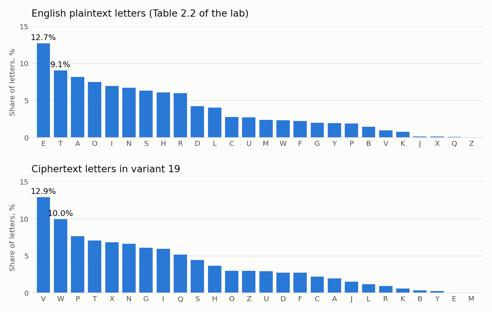

# Lab 2 · Cryptanalysis of Monoalphabetic Ciphers

**Nichita Rusnac, FAF-242** · UTM, FCIM · Cryptography and Security · 6 November 2026

**Topic:** breaking a monoalphabetic substitution cipher with frequency analysis. **Variant:** V19 (number 19 in the group list).

**Task.** An intercepted message was encrypted with a monoalphabetic cipher, only the letters were encrypted, and the plaintext is assumed to be English. Recover the original message, describing the process the same way as section 2.3 of the lab.

## 1. Theory

A monoalphabetic cipher always replaces a given letter with the same letter. The key can be any of the 26! orderings of the alphabet, far too many to try, but the substitution changes only the letters' names and not how often they appear. If E is 12.7% of English text, then whichever letter stands for E is also about 12.7% of the ciphertext.

Frequencies alone only give candidates, because neighbouring ranks are close and a real text differs from the average. The rest comes from the structure of the language: one-letter words (A, I), very common short words (THE, AND, OF, TO), digraphs (TH, HE), trigraphs (-ING) and doubled letters (LL, SS). After each guess, partly readable words suggest the next letter. As the lab says, this needs human judgement.

## 2. How I worked

The lab suggests the service at crypto.interactive-maths.com. I wrote the same counts and substitutions in Python instead, so that every number in this report can be recomputed and checked by a test:

- `cryptanalysis.py`: letter, word and n-gram statistics, and applying a partial key
- `attack.py`: the steps of the attack below, each with its evidence
- `make_chart.py`: the figure in section 3

```python
    for char in text:
        upper = char.upper()
        if upper not in ALPHABET:
            result.append(char)
        elif upper in key:
            result.append(key[upper].lower())
        else:
            result.append(upper)
```

This is the core of `apply_key`. As in the lab's example, solved letters become lowercase and unsolved ones stay uppercase, so a partial plaintext is easy to read. Anything that isn't a letter was never encrypted and is copied unchanged.

## 3. Letter frequencies

V19 has 3,230 letters. These are their frequencies, in descending order (the equivalent of Tables 2.3 and 2.4 of the lab):

| cipher | V | W | P | T | X | N | G | I | Q | S | H | O | Z |
|---|---|---|---|---|---|---|---|---|---|---|---|---|---|
| count | 418 | 322 | 247 | 229 | 221 | 215 | 197 | 192 | 167 | 143 | 118 | 97 | 97 |
| % | 12.9 | 10.0 | 7.6 | 7.1 | 6.8 | 6.7 | 6.1 | 5.9 | 5.2 | 4.4 | 3.7 | 3.0 | 3.0 |

| cipher | U | D | F | C | A | J | L | R | K | B | Y | E | M |
|---|---|---|---|---|---|---|---|---|---|---|---|---|---|
| count | 95 | 88 | 88 | 72 | 64 | 49 | 39 | 31 | 20 | 11 | 9 | 1 | 0 |
| % | 2.9 | 2.7 | 2.7 | 2.2 | 2.0 | 1.5 | 1.2 | 1.0 | 0.6 | 0.3 | 0.3 | 0.0 | 0.0 |



*Figure 1. English and V19 have almost the same shape: two tall bars, a long middle and a thin tail. It's the same language with the letters renamed.*

The most useful patterns in the ciphertext:

| pattern | most frequent |
|---|---|
| one-letter words | `T` (16) |
| two-letter words | `NC` (16), `AV` (12), `XG` (12), `XW` (12), `WN` (8) |
| three-letter words | `WQV` (44), `TGO` (11), `CNI` (8), `GNW` (7), `LVF` (7) |
| four-letter words | `WQTW` (16), `ZDPW` (4), `QTKV` (3) |
| digraphs | `WQ` (91), `QV` (81), `VI` (56) |
| trigraphs | `WQV` (63), `QTW` (19), `WQT` (18) |
| doubled letters | `SS` (13), `PP` (13), `WW` (9) |

## 4. The attack, step by step

Section 2.3 of the lab shows the whole text after every step. I follow the same steps but show only the first words, because the V19 text appears to be taken from a published book. They are enough to watch the message appear:

```
Cinz wqvpv wrn cdgotzvgwts uixghxusvp cni pvsvhwxgj dptasv cxvsohxuqvip, Lvihlqnccp ovodhvo
```

**Step 1: V → e, W → t.** V (12.9%) and W (10.0%) are the two most frequent letters, and E (12.7%) and T (9.06%) are the two most frequent in English.

```
CINZ tQePe tRN CDGOTZeGtTS UIXGHXUSeP CNI PeSeHtXGJ DPTASe CXeSOHXUQeIP, LeIHLQNCCP OeODHeO
```

**Step 2: Q → h.** `WQV` is by far the most frequent word (44 times) and now reads `tQe`: the. `WQ` and `QV` are also the two most frequent digraphs, like TH and HE.

```
CINZ thePe tRN CDGOTZeGtTS UIXGHXUSeP CNI PeSeHtXGJ DPTASe CXeSOHXUheIP, LeIHLhNCCP OeODHeO
```

**Step 3: T → a.** T is the only one-letter word (16 times), so it is a or i. `WQTW` (16 times) reads `thTt`: that.

```
CINZ thePe tRN CDGOaZeGtaS UIXGHXUSeP CNI PeSeHtXGJ DPaASe CXeSOHXUheIP, LeIHLhNCCP OeODHeO
```

**Step 4: G → n, O → d.** `TGO` is the second most frequent three-letter word (11 times) and reads `aGO`: and.

```
CINZ thePe tRN CDndaZentaS UIXnHXUSeP CNI PeSeHtXnJ DPaASe CXeSdHXUheIP, LeIHLhNCCP dedDHed
```

**Step 5: N → o, C → f.** `NC` is the most frequent two-letter word (16 times). `WN` (8 times) reads `tN`: to, so N is o, and `NC` then reads `oC`: of.

```
fIoZ thePe tRo fDndaZentaS UIXnHXUSeP foI PeSeHtXnJ DPaASe fXeSdHXUheIP, LeIHLhoffP dedDHed
```

**Step 6: X → i, P → s.** `XG` and `XW` (12 times each) read `Xn` and `Xt`: in and it. `XP` (7 times) then reads `iP`: is, and P is frequent (7.6%).

```
fIoZ these tRo fDndaZentaS UIinHiUSes foI seSeHtinJ DsaASe fieSdHiUheIs, LeIHLhoffs dedDHed
```

**Step 7: I → r, R → w.** `CNI` (8 times) reads `foI`: for. `RTP` (4 times) reads `Ras`: was.

```
froZ these two fDndaZentaS UrinHiUSes for seSeHtinJ DsaASe fieSdHiUhers, LerHLhoffs dedDHed
```

**Step 8: A → b, D → u, Z → m.** `AV` (12 times) reads `Ae`: be. `ADW` (5 times) reads `bDt`: but. `ZDPW` (4 times) reads `Zust`: must.

```
from these two fundamentaS UrinHiUSes for seSeHtinJ usabSe fieSdHiUhers, LerHLhoffs deduHed
```

**Step 9: S → l, F → y, K → v.** `TSS` reads `aSS`: all, and SS is the joint most frequent doubled letter. `ZTF` reads `maF`: may. `QTKV` (3 times) reads `haKe`: have.

```
from these two fundamental UrinHiUles for seleHtinJ usable fieldHiUhers, LerHLhoffs deduHed
```

**Step 10: L → k, U → p, J → g.** `LVF` (7 times) reads `Ley`: key. `UTIW` reads `Uart`: part. `XGJ` (13 times) is a top trigraph that reads `inJ`: the ending -ing.

```
from these two fundamental prinHiples for seleHting usable fieldHiphers, kerHkhoffs deduHed
```

**Step 11: H → c, B → q, Y → x, E → j.** The rest is almost readable. `HXUQVI` reads `Hipher`: cipher. `IVBDXIVZVGWP` reads `reBuirements`: requirements. `PXY` reads `siY`: six. `WNHNGEDIV` reads `toconEure`: to conjure, which is the only place E occurs.

```
from these two fundamental principles for selecting usable fieldciphers, kerckhoffs deduced
```

**Step 12: M → z.** M never occurs in V19, so the text itself can't show its meaning. But M is the only cipher letter left and z the only plain letter left, and a substitution is one-to-one, so M → z by elimination.

## 5. The result

The recovered alphabet (the equivalent of Table 2.5 of the lab):

| cipher | A | B | C | D | E | F | G | H | I | J | K | L | M | N | O | P | Q | R | S | T | U | V | W | X | Y | Z |
|---|---|---|---|---|---|---|---|---|---|---|---|---|---|---|---|---|---|---|---|---|---|---|---|---|---|---|
| plain | b | q | f | u | j | y | n | c | r | g | v | k | z | o | d | s | h | w | l | a | p | e | t | i | x | m |

The sender's key is the same table read the other way:

| plain | A | B | C | D | E | F | G | H | I | J | K | L | M | N | O | P | Q | R | S | T | U | V | W | X | Y | Z |
|---|---|---|---|---|---|---|---|---|---|---|---|---|---|---|---|---|---|---|---|---|---|---|---|---|---|---|
| cipher | T | A | H | O | V | C | J | Q | X | E | L | S | Z | G | N | U | B | I | P | W | D | K | R | Y | F | M |

The message is a passage on the practical requirements for field ciphers, and it discusses Kerckhoffs and Kasiski. I don't reproduce it in full here for the reason given in section 4. `python3 attack.py --full` prints all of it from the lab's PDF.

To check the result objectively, and not only by reading it, I compared every word with the macOS dictionary:

```
$ python3 attack.py --check
letters still undecided: none
words: 597
  in the macOS dictionary:        536 (89.8%)
  two dictionary words joined:    51 (8.5%)
  not recognised:                 10 (1.7%)
  most common not recognised:     [('KERCKHOFFS', 8), ('CODEBOOKREQUIRES', 1), ('KASISKI', 1)]
```

The "joined" words come from the PDF, which lost some spaces at line breaks. The 10 unrecognised words are only 3 distinct ones: two surnames, and one run of three joined words.

## 6. Tests

28 unit tests cover the statistics, the lab's own example (`GFS WMY OG LGDVS MF SFNKYHOSU ESLLMRS` → `one way to solve an encrypted message`) and the attack on V19. For V19 the tests recompute every count, ranking and partial reading quoted in the steps above, so the report can't drift from the data.

```
$ python3 -m unittest discover tests
............................
----------------------------------------------------------------------
Ran 28 tests in 0.049s

OK
```

## 7. Conclusions

- **A huge key space didn't help.** 26! keys can't be searched, yet about a dozen small deductions broke the cipher, because the statistics of English pass straight through the substitution.
- **Frequencies open the attack, and words finish it.** Only the first step relied on frequencies alone. The top two letters did match E and T, but below them the order differs from English: P is third in the ciphertext, yet it stands for s, which is seventh in English. Sorting the table and substituting would have failed, as the lab warns. Common short words did the real work.
- **Long texts help the attacker.** With 3,230 letters the two distributions in Figure 1 are almost identical. Even the rare letters gave themselves away: E occurs once, and one word was enough.
- **One letter can't be seen at all.** M doesn't occur in V19, and only the fact that a substitution is one-to-one gives M → z.

## 8. Source code

GitHub: **https://github.com/Nichita111/CS_labs/tree/main/lab2**

The ciphertext and the lab's PDF are course material, so they aren't in the repository. With the PDF on your machine (macOS):

```
python3 extract_variant.py "<path to the lab 2 PDF>" 19
python3 attack.py --stats --stages --key --check
python3 attack.py --full
python3 -m unittest discover tests -v
```
