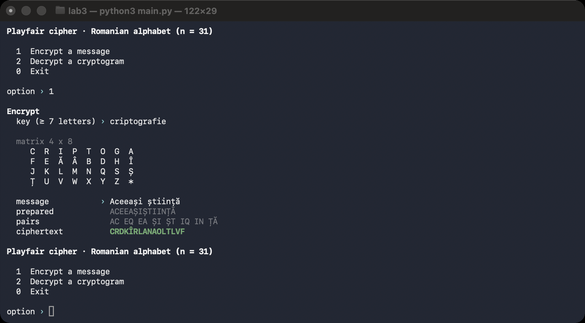
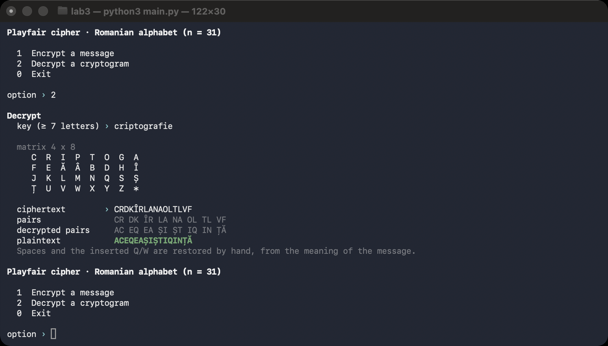
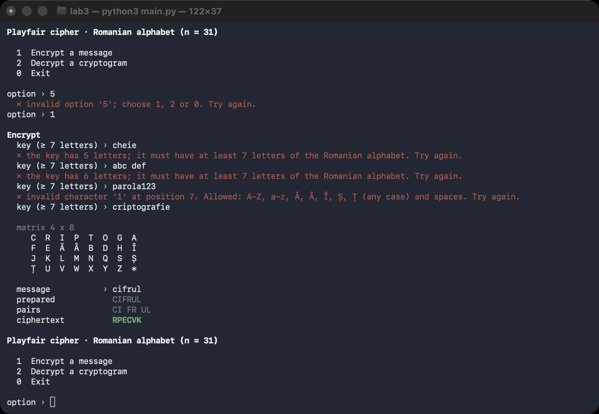
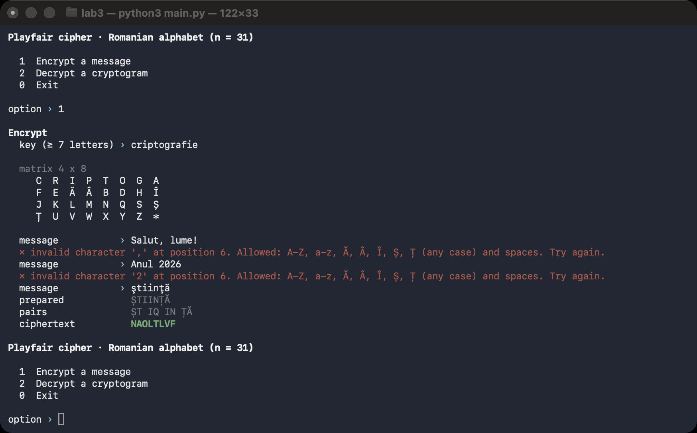
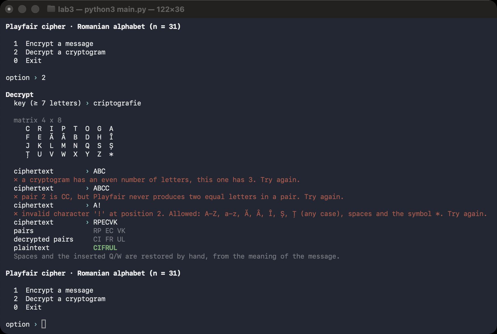

# Lab 3 · Polyalphabetic Ciphers: Playfair

**Nichita Rusnac, FAF-242** · UTM, FCIM · Cryptography and Security · 6 November 2026

**Topic:** the Playfair cipher, implemented for the Romanian alphabet (n = 31). **Task:** 3.1, because my number in the group list (19) is odd.

I wrote the program in Python 3.13 on macOS, using only the standard library. All screenshots and outputs below come from my own runs.

## 1. Theory

Monoalphabetic ciphers fall to frequency analysis because a letter is always replaced by the same letter (see Lab 2). Playfair avoids that by encrypting **pairs** of letters: what a letter becomes depends on its partner. It was invented by Charles Wheatstone in 1854 and named after Lord Playfair, who promoted it.

**Preparing the text.** Remove the spaces, write it in uppercase and split it into pairs. A pair can't hold two equal letters, so a rare letter is inserted between them. If one letter is left at the end, it is completed with an extra letter.

**The matrix.** Write the key with repeated letters removed, row by row, then the rest of the alphabet.

**Encrypting a pair:**
1. In different rows and columns, each letter is replaced by the one in its own row and in the other letter's column.
2. In the same row, each letter is replaced by the one to its right, wrapping around.
3. In the same column, each letter is replaced by the one below it, wrapping around.

**Decrypting** uses the same rules but moves left and up. The rectangle rule is its own inverse.

**Key space.** My matrix can hold the 31 letters in any order, so there are at most 31! ≈ 8.2 · 10³³ keys, far too many to search.

## 2. How I implemented it

The program is split into small files:
- `alphabet.py`: the letters and the input clean-up (the same approach as Lab 1)
- `playfair.py`: the cipher
- `validation.py`: the key, message and cryptogram checks
- `main.py`: the menu

### The matrix for 31 letters

The classic 5 × 5 matrix doesn't fit, and 31 is prime, so no rectangle holds 31 letters exactly. The lab allows other sizes, dropping the rarest letters, or filling free cells with any symbol. I wanted to keep all 31 letters, because the task is about the full alphabet, and to have as few non-letters as possible. So I used **4 rows × 8 columns**, which leaves one free cell for the symbol `*`.

```python
def build_matrix(key, alphabet=ROMANIAN_ALPHABET, rows=ROWS, columns=COLUMNS, filler=FILLER):
    """Key letters first (each kept only once), then the rest of the alphabet by rows."""
    cells = []
    for letter in list(key) + list(alphabet):
        if letter not in cells:
            cells.append(letter)
    free_cells = rows * columns - len(cells)
    if free_cells < 0:
        raise ValueError(f"a {rows} x {columns} matrix cannot hold {len(cells)} letters")
    cells.extend(filler * free_cells)
    return tuple(tuple(cells[row * columns:(row + 1) * columns]) for row in range(rows))
```

The sizes are parameters, so the same function also builds the lab's 5 × 5 English matrix for testing. For the key `CRIPTOGRAFIE`:

```
C R I P T O G A
F E Ă Â B D H Î
J K L M N Q S Ș
Ț U V W X Y Z *
```

The cost of the free cell is that a ciphertext can occasionally contain `*`: for example `YZ` encrypts to `Z*`. Only cryptograms may contain it, and a message may not.

### Splitting into pairs

```python
    while position < len(text):
        first = text[position]
        second = text[position + 1] if position + 1 < len(text) else None
        if second is None:
            pairs.append(first + (padding or _other_than(first, separators)))
            position += 1
        elif first == second:
            inserted = _other_than(first, separators, avoid=last_inserted)
            pairs.append(first + inserted)
            last_inserted = inserted
            position += 1
        else:
            pairs.append(first + second)
            last_inserted = None
            position += 2
```

For a double, only one letter is consumed, so the second one starts the next pair. English uses Q, X and Z as inserted letters. For Romanian I use the two rarest letters from Table 2.1 of Lab 2: **Q** (0.00%) and **W** (0.03%). As in the lab's example (`SSS` → `SX SZ S…`), a second double in a row gets the other letter, and `QQ` gets a W.

### The three rules

```python
    for first, second in pairs:
        row_1, column_1 = position[first]
        row_2, column_2 = position[second]
        if row_1 == row_2:
            result.append(matrix[row_1][(column_1 + step) % columns]
                          + matrix[row_2][(column_2 + step) % columns])
        elif column_1 == column_2:
            result.append(matrix[(row_1 + step) % rows][column_1]
                          + matrix[(row_2 + step) % rows][column_2])
        else:
            result.append(matrix[row_1][column_2] + matrix[row_2][column_1])
```

`step` is +1 to encrypt and −1 to decrypt, so one function does both. `%` handles the wrap-around in both directions.

### Validation

```python
def parse_ciphertext(raw):
    """A cryptogram: an even number of symbols, and never a double inside a pair."""
    text = prepare_text(raw, extra=FILLER, hint=CIPHERTEXT_HINT)
    if len(text) % 2:
        raise ValueError(f"a cryptogram has an even number of letters, this one has {len(text)}.")
    for start in range(0, len(text), 2):
        if text[start] == text[start + 1]:
            raise ValueError(f"pair {start // 2 + 1} is {text[start:start + 2]}, but Playfair "
                             "never produces two equal letters in a pair.")
    return text
```

Every input has a parser that returns a valid value or raises `ValueError` with a message stating the allowed range, and the menu asks for the same value again.
- **Message:** Romanian letters and spaces only. Cedilla letters (ş, ţ) are accepted as Ș and Ț.
- **Key:** at least 7 letters. It may be a short phrase, as the lab recommends; spaces are dropped and aren't counted.
- **Cryptogram:** the checks above. These catch typos that a letter check alone would miss.

### Checking the results by hand

With the matrix above, `CIFRUL` splits into `CI FR UL`:
- **CI:** C and I are in the same row, so each moves right: `RP`.
- **FR:** different rows and columns. F's row at R's column is E, and R's row at F's column is C: `EC`.
- **UL:** different rows and columns. U's row at L's column is V, and L's row at U's column is K: `VK`.

So the ciphertext is `RPECVK`, the same as the program prints (Figure 3).

### Tests

I wrote 44 unit tests with `unittest`. The strongest check is the lab's own example. With the key `FIRST AMENDMENT` on a 5 × 5 matrix, the program reproduces the lab's matrix and its exact cryptogram in both directions, plus the three named examples (`NP` → `EQ`, `IT` → `RF`, `CW` → `OI`).

The rest covers:
- the Romanian matrix, the separators and the padding
- round trips with 500 random keys and texts
- every pair of different cells in the matrix
- every kind of invalid input
- the menu itself, driven with simulated keyboard input

```
$ python3 -m unittest discover tests
............................................
----------------------------------------------------------------------
Ran 44 tests in 0.037s

OK
```

**A slip in the lab's example.** The test also showed that the list of prepared pairs in the lab doesn't quite match its own message. It has an extra M (`LM MA KE` for "SHALL MAKE"), loses `HE` after "PROHIBITING" (`IN GT FR`) and has an extra R (`BR RI` for "ABRIDGING"). The cipher arithmetic on those pairs is right, so I test encryption and decryption on the lab's pairs and test the splitting rule on its correct segments.

## 3. Results

These are screenshots of `python3 main.py` running in the macOS Terminal. So that I could retake them after a change, `scripts/take_screenshots.sh` typed the inputs into the window from the lists in `scripts/scenarios/`. What I type follows the `›` arrow, results are green, and errors are red lines starting with `✗`.



*Figure 1. Encryption with the key `criptografie`. The program shows the matrix and the pairs. `Aceeași știință` has two doubles (EE, II), and each one gets a Q: `EQ`, `IQ`.*



*Figure 2. Decrypting Figure 1's cryptogram. The program stops at `ACEQEAȘIȘTIQINȚĂ`. As the lab says, the last phase is done by hand: removing the inserted Qs and adding spaces from the meaning gives `ACEEAȘI ȘTIINȚĂ`.*



*Figure 3. A wrong menu option, a key that's too short, a phrase with too few letters (`abc def` has 6), and a key with a digit. The valid key then encrypts `cifrul` to the `RPECVK` computed by hand above.*



*Figure 4. The comma and the digit are rejected, and the message suggests the correct range. The last message uses the cedilla letters ş and ţ, which are accepted as Ș and Ț.*



*Figure 5. A cryptogram with an odd length, a pair of equal letters, and an invalid character are all rejected.*

## 4. Conclusions

- **Playfair hides single-letter frequencies.** In Figure 1, E becomes D in the pair `EQ` and Î in the pair `EA`, so counting letters no longer maps one letter to one letter. This is why it was a real step up from the ciphers in labs 1 and 2.
- **It's still breakable.** A given pair always encrypts to the same pair, so frequencies of pairs still show. It also leaks structure: reversing a pair reverses its ciphertext (`AB` → `XY` means `BA` → `YX`), and a letter never encrypts to itself. My tests confirm both on the Romanian matrix. A big key space doesn't help here either; as the lab says, a modern computer breaks it in seconds.
- **Moving past 26 letters takes real decisions.** The textbook 5 × 5 doesn't carry over. The matrix size, the free cell and the inserted letters are all choices with costs, and I chose to keep all 31 letters at the cost of a rare `*` in the ciphertext.
- **Testing against known answers pays off.** Using the lab's own example caught my wrong assumptions, and also the slips in the example itself.

## 5. Source code

GitHub: **https://github.com/Nichita111/CS_labs/tree/main/lab3**

```
python3 main.py
python3 -m unittest discover tests -v
```
