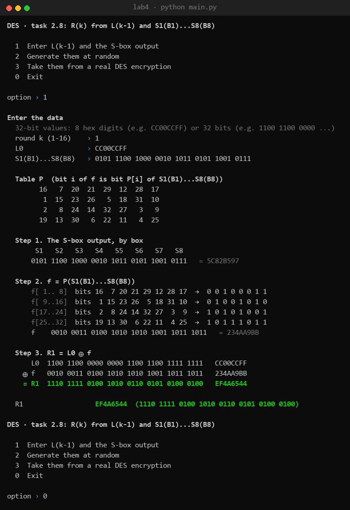
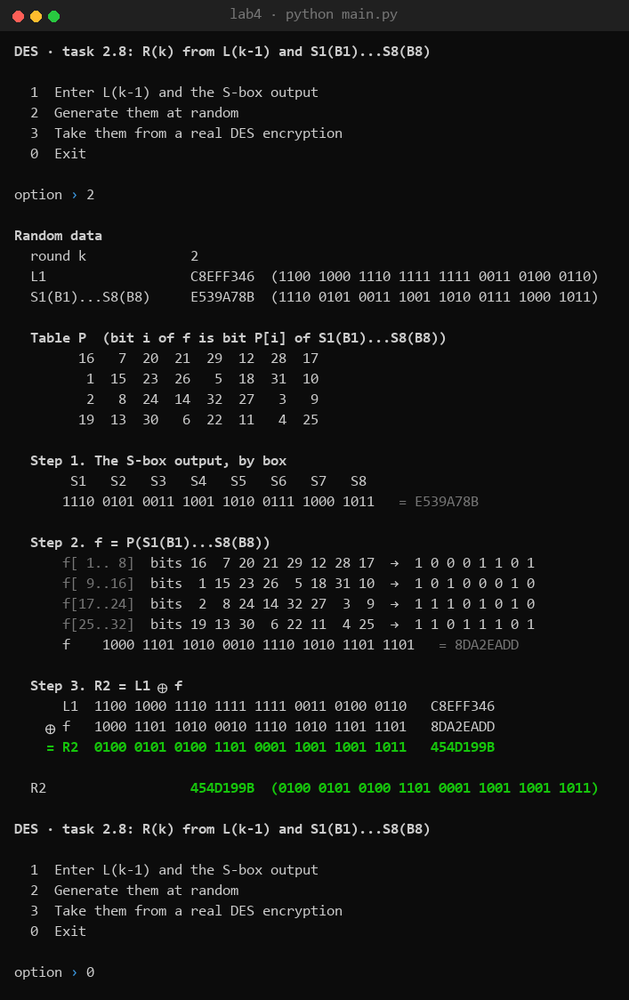
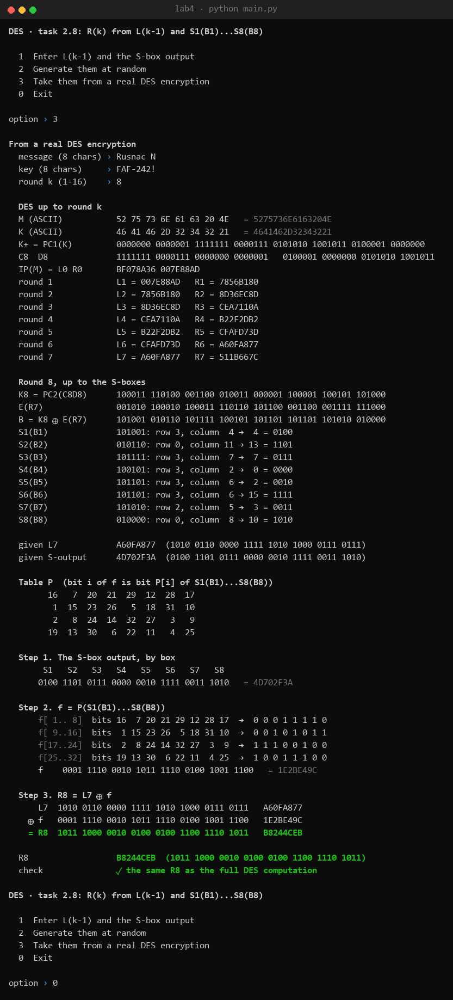
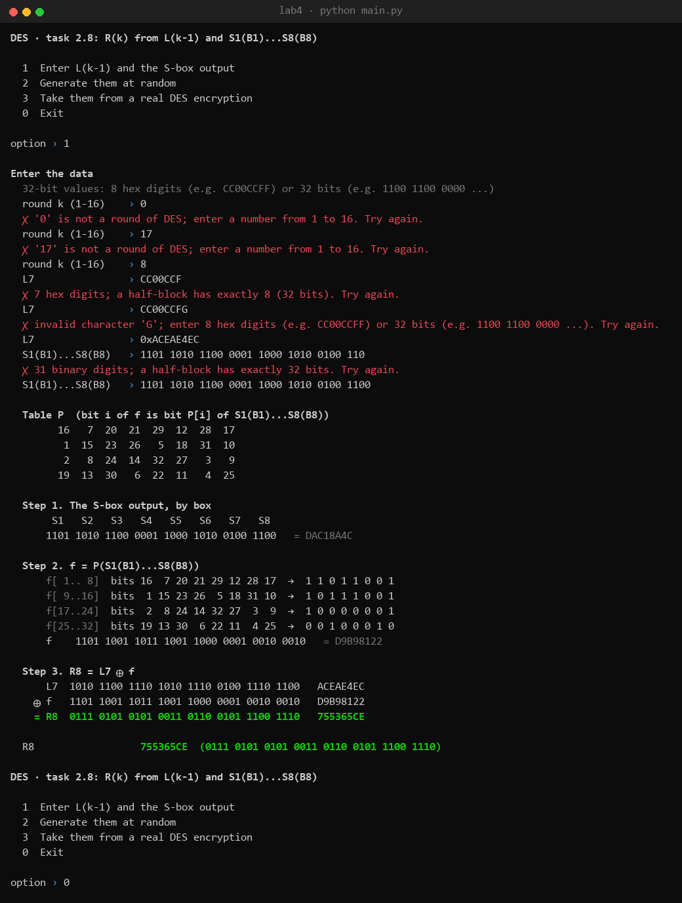
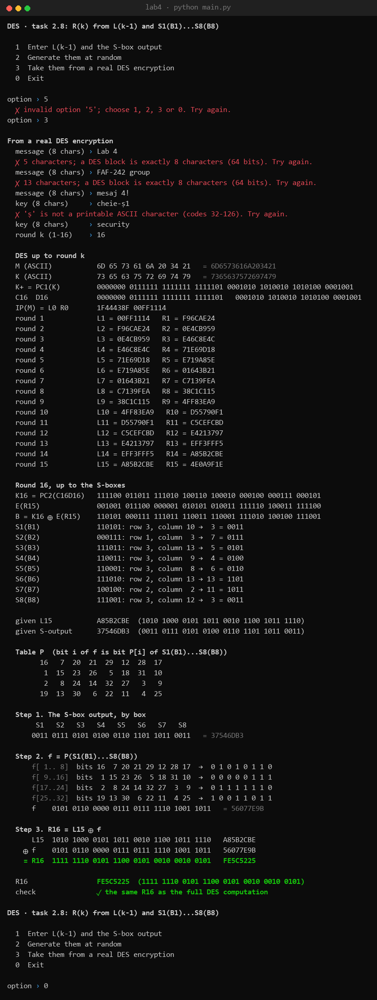

# Lab 4 · Block Ciphers: the DES Algorithm

**Nichita Rusnac, FAF-242** · UTM, FCIM · Cryptography and Security · 18 November 2026

**Topic:** the Data Encryption Standard (DES). **Task:** 2.8, because my number in the group list is 19 and 19 mod 11 = 8:

> Compute R(i) for round k of DES, given L(k-1) and the result of the S-boxes.

I wrote the program in Python 3.13 on Windows, using only the standard library (the image script also needs Pillow). All outputs below come from my own runs.

## 1. Theory

DES is a symmetric **block cipher**: it encrypts 64-bit blocks with a 64-bit key, of which only 56 bits are used (every 8th bit is a parity bit). It was published as FIPS 46 in 1977 and is built as a **Feistel network** of 16 rounds.

**One block, from start to end:**
1. **Initial permutation.** IP reorders the 64 bits of the message M. The result is split into two halves of 32 bits, L0 and R0.
2. **16 rounds.** For i = 1, …, 16:

   L(i) = R(i-1)
   R(i) = L(i-1) ⊕ f(R(i-1), K(i))
3. **Final permutation.** The halves are swapped one last time to R16 L16, and IP⁻¹ gives the ciphertext.

**The round function f(R(i-1), K(i)):**
1. **Expansion E:** the 32 bits of R(i-1) become 48. Each group of 4 bits is copied together with its two neighbours.
2. **Key mixing:** K(i) ⊕ E(R(i-1)), 48 bits, split into eight 6-bit groups B1 … B8.
3. **S-boxes:** each S(j) turns its 6 bits into 4. The first and last bit of B(j) choose the row (0-3), the middle four bits the column (0-15). The 8 results together are S1(B1)…S8(B8), 32 bits. The S-boxes are the only non-linear part of DES; everything else is permutations and XOR.
4. **Permutation P:** the 32 bits are reordered. Bit i of the result is bit P[i] of the S-box output. The result is f.

**Key schedule.** PC1 drops the 8 parity bits and permutes the other 56: this is **K+**. It's split into C0 and D0 (28 bits each). For each round, both halves are rotated left by 1 or 2 positions (1 in rounds 1, 2, 9 and 16, 2 in the others, 28 in total). PC2 then takes 48 of the 56 bits of C(i)D(i): this is the round key K(i).

**Decryption** is the same algorithm with the round keys in reverse order, K16 first. This works because a Feistel round can be undone without inverting f: if L(i) = R(i-1) is known, then L(i-1) = R(i) ⊕ f(L(i), K(i)).

### Where task 2.8 fits

Task 2.8 starts right after step 3 of f: the S-boxes are done, and only the last two operations of the round are left.

```
R(k) = L(k-1) ⊕ P( S1(B1) S2(B2) … S8(B8) )
```

Table P (FIPS 46-3):

```
16   7  20  21  29  12  28  17
 1  15  23  26   5  18  31  10
 2   8  24  14  32  27   3   9
19  13  30   6  22  11   4  25
```

## 2. How I implemented it

The program is split into small files:
- `des_tables.py`: the tables of DES (IP, IP⁻¹, E, P, PC1, PC2, the shifts and S1-S8)
- `des.py`: the whole DES algorithm, which records every intermediate value
- `task.py`: task 2.8
- `validation.py`: the input checks
- `main.py`: the menu
- `scripts/render_screenshots.py`: the images for this report

### The task itself

```python
def compute_right(round_number, left_prev, s_output):
    """R(k) = L(k-1) XOR P(S1(B1)...S8(B8))."""
    ...
    f = permute(s_output, P)
    return Solution(round_number, left_prev, s_output, f, xor(left_prev, f))
```

Bits are strings of `0` and `1`, so every value can be printed the way the lab writes it, and tables are used with the same 1-based positions as the standard:

```python
def permute(bits, table):
    """Output bit i is input bit table[i] (positions count from 1)."""
    return "".join(bits[position - 1] for position in table)
```

The same `permute` does IP, IP⁻¹, E, P, PC1 and PC2.

### Three ways to get the data

The lab asks for input typed by the user or generated at random. The menu has both, and a third one:
1. **Typed by the user.** The round k, L(k-1) and S1(B1)…S8(B8). Each 32-bit value can be typed as 8 hex digits (`CC00CCFF`, `0xcc00ccff`) or as 32 bits, with spaces anywhere.
2. **Random.** k, L(k-1) and the S-box output are generated.
3. **From a real DES encryption.** The user types a message and a key of 8 characters each, as in task 2.1, and a round k. The program runs DES up to that round and shows K, K+, C(k), D(k), IP(M), all the earlier rounds, K(k), E(R(k-1)), B1…B8 and each S-box lookup. Then it gives only L(k-1) and the S-box output to task 2.8, and checks that the R(k) it finds is the one DES computed.

The third option exists because random numbers can't show that the answer is right. With a real encryption, the same R(k) is computed twice, by two different paths.

### All the intermediate steps

As the lab asks, the program prints table P and every step:
- **Step 1:** the S-box output, split by box.
- **Step 2:** the permutation P, row by row: the positions taken from the S-box output, and the bits found there.
- **Step 3:** the XOR, written in columns, in binary and in hex.

### Validation

Every input has a parser that returns a valid value or raises `ValueError` with a message stating what is allowed, and the menu asks for the same value again.
- **Round:** a whole number from 1 to 16.
- **32-bit value:** exactly 8 hex digits or exactly 32 bits. The error says how many digits were typed. A value of 8 zeros and ones, such as `10101010`, is read as hex, because 8 digits can only be a full value in hex.
- **Message and key (option 3):** exactly 8 printable ASCII characters (codes 32-126), spaces included, because DES takes 8 bits per character. Letters like ș are rejected, since they're not one byte.

### Checking the results by hand

I take the classic example from J. Orlin Grabbe, *The DES Algorithm Illustrated* (M = `0123456789ABCDEF`, K = `133457799BBCDFF1`), round 1: L0 = `CC00CCFF` and S1(B1)…S8(B8) = `5C82B597`.

**Step 1.** By box: `0101 1100 1000 0010 1011 0101 1001 0111`.

**Step 2.** The first row of P is 16, 7, 20, 21, …
- f₁ = bit 16 = the last bit of S4's `0010`: **0**
- f₂ = bit 7 = the 3rd bit of S2's `1100`: **0**
- f₃ = bit 20 = the last bit of S5's `1011`: **1**
- f₄ = bit 21 = the first bit of S6's `0101`: **0**

So f starts with `0010`. Continuing the same way gives f = `0010 0011 0100 1010 1010 1001 1011 1011` = `234AA9BB`.

**Step 3.** XOR, one hex digit at a time:

| L0 | C | C | 0 | 0 | C | C | F | F |
|---|---|---|---|---|---|---|---|---|
| f | 2 | 3 | 4 | A | A | 9 | B | B |
| **R1** | **E** | **F** | **4** | **A** | **6** | **5** | **4** | **4** |

So R1 = `EF4A6544`. This is the same as the program prints (Figure 1) and as Grabbe's R1 = `1110 1111 0100 1010 0110 0101 0100 0100`.

### Tests

I wrote 51 unit tests with `unittest`.

**DES itself (22 tests).** Task 2.8 is only correct if table P and the S-box output are right, and the teacher asks about the whole algorithm, so I tested the whole algorithm too:
- **Grabbe's example, value by value:** K+, C0, D0, C1, D1, K1, K16, L0, R0, E(R0), K1 ⊕ E(R0), the S-box output, f, R1, L16, R16 and the ciphertext `85E813540F0AB405`.
- **Published known answers,** in both directions: the NIST test `0101010101010101` / `8000000000000000` → `95F8A5E5DD31D900`, the FIPS 81 example "Now is t" → `3FA40E8A984D4815`, and key `0E329232EA6D0D73`, which takes `8787878787878787` to `0000000000000000`.
- **Properties of DES:** the parity bits don't change the result; the complementation property (encrypting the complemented message with the complemented key gives the complemented ciphertext); the weak key `0101010101010101` undoes its own encryption; 100 random blocks decrypt back.
- **The tables:** each S-box row is a permutation of 0-15, IP⁻¹ undoes IP, PC1 drops exactly the parity bits, and the shifts add up to 28.

**Task 2.8 (8 tests).** The main one takes 30 random encryptions and, for each of the 16 rounds, gives `compute_right` only L(k-1) and the S-box output: the R(k) it returns is DES's own R(k) all 480 times. Other tests send one bit through P at a time to check that it lands where the table says, check how P spreads each S-box (see the conclusions), and redo the hand check above.

**Input and menu (21 tests).** Every kind of invalid input, and the menu itself, driven with simulated keyboard input.

```
> python -m unittest discover tests
...................................................
----------------------------------------------------------------------
Ran 51 tests in 0.107s

OK
```

## 3. Results

`python main.py` runs in the Windows terminal. For this report, `scripts/render_screenshots.py` runs the program with the inputs from `scripts/scenarios/` and draws its exact output, colours included, as a terminal window. What I type follows the `›` arrow, results are green, and errors are red lines starting with `✗`. Random data is seeded so the images can be regenerated.



*Figure 1. Option 1 with Grabbe's round 1. Table P, the S-box output by box, the bits P takes for each row of f, and the XOR. R1 = `EF4A6544`, as computed by hand above.*



*Figure 2. Option 2: k = 2 and two random 32-bit values. The labels follow k: L1 and R2.*



*Figure 3. Option 3 with the message `Rusnac N`, the key `FAF-242!` and round 8 (my task number). The program shows K+, C8 and D8, IP(M) and rounds 1-7, then K8, E(R7), B1…B8 and each S-box lookup (B1 = `101001`: row 3, column 4 → 4). Task 2.8 then gets L7 = `A60FA877` and S-output = `4D702F3A`, finds f = `1E2BE49C` and R8 = `B8244CEB`, and the last line confirms it's the R8 of the real encryption.*



*Figure 4. Rounds 0 and 17 are rejected, then a value with 7 hex digits, one with a `G`, and a binary value with 31 bits. `0xACEAE4EC` is accepted with its prefix.*



*Figure 5. A wrong menu option, a message of 5 and one of 13 characters, and a key with ș, which isn't ASCII. The valid inputs then go through all 16 rounds: the last line checks R16.*

## 4. Conclusions

- **The end of a round is linear.** Once the S-boxes are known, R(k) is just a fixed permutation and an XOR: anyone who knows L(k-1) and S1(B1)…S8(B8) can compute it, as task 2.8 shows. All of the security of DES comes from the S-boxes, the only non-linear step, and from repeating the round 16 times.
- **P spreads the S-boxes apart.** S1's 4 output bits land in f at positions 9, 17, 23 and 31. After E, they reach 6 of the 8 S-boxes of the next round, and never S1 itself; a test checks this for every S-box. After a few rounds every output bit depends on every input bit. This is the diffusion that Shannon asked of a good cipher.
- **The Feistel structure makes this possible.** f is never inverted, not even for decryption, so S-boxes that lose information (6 bits in, 4 out) and P can be chosen freely.
- **56 bits is too little today.** DES was broken by brute force in 1998 (the EFF's "Deep Crack" machine, in 56 hours). It lived on as 3DES, which NIST also disallowed after 2023, and it was replaced by AES.
- **Checking each step against the full algorithm paid off.** Having two independent ways to reach R(k), and Grabbe's published intermediate values, means a wrong table entry anywhere would be caught by the tests.

## 5. Source code

GitHub: **https://github.com/Nichita111/CS_labs/tree/main/lab4**

```
python main.py
python -m unittest discover tests -v
```
